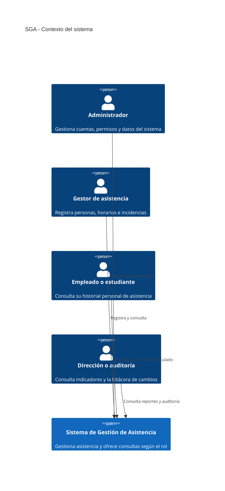
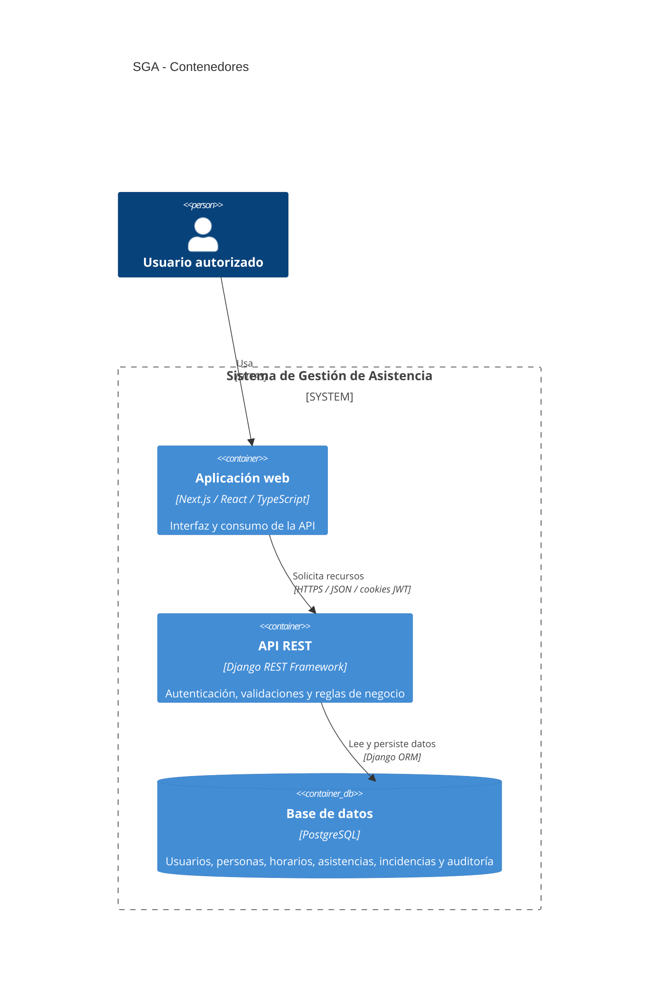
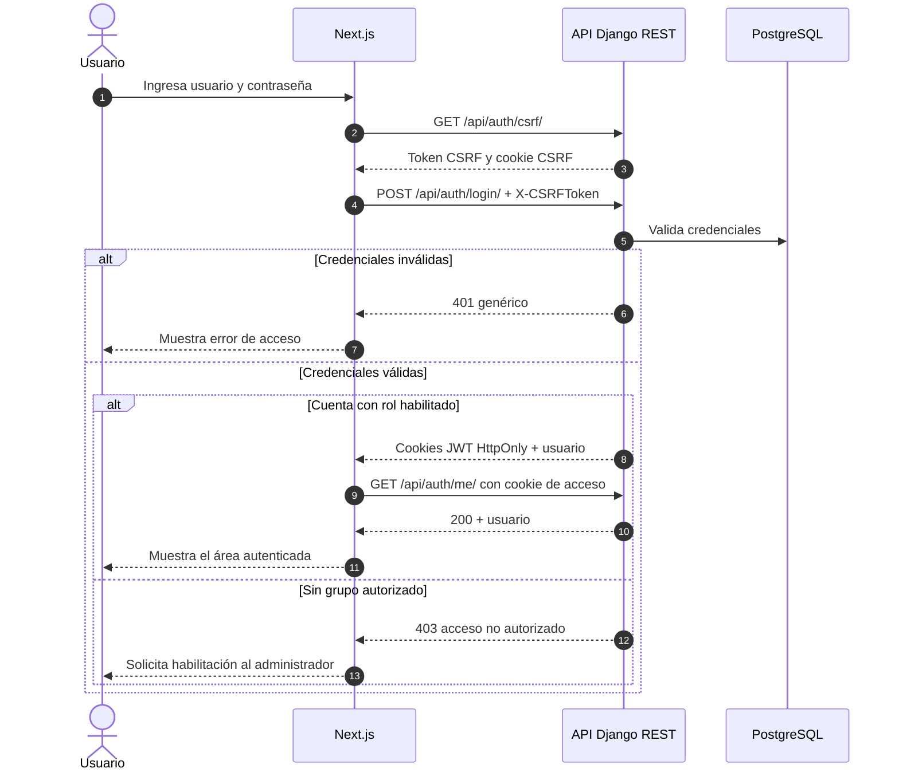
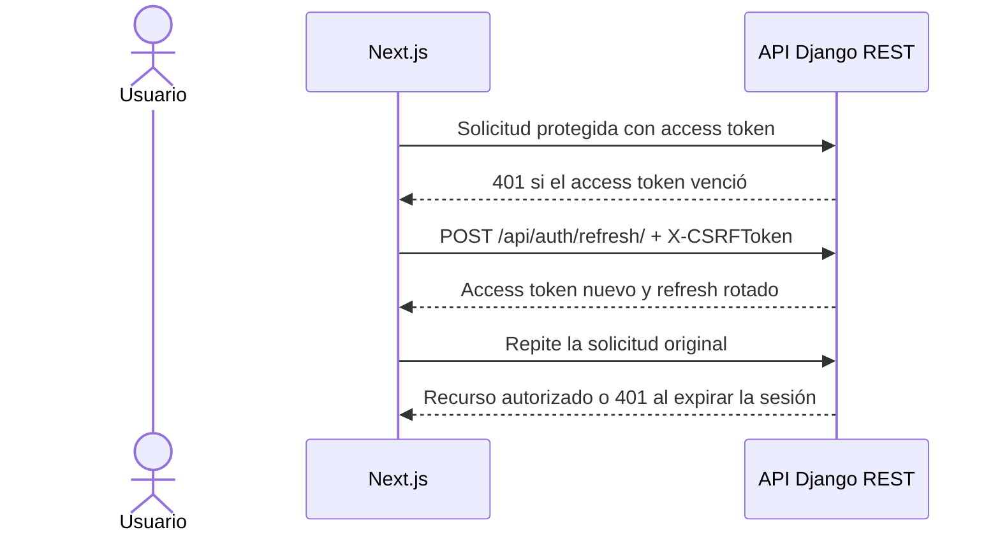

# Arquitectura del Sistema de Gestión de Asistencia

La arquitectura del repositorio separa interfaz, servicio web y persistencia.
Incluye módulos operativos, configuración de cuentas, auditoría y consulta
personal con permisos aplicados en la API. La validación con usuarios piloto y el
alojamiento público siguen pendientes.

## C4 nivel 1: contexto

## C4 nivel 2: contenedores

## Inicio de sesión y consulta protegida

## Renovación de sesión

## Endpoints de datos

| Recurso | Endpoint base | Verbos | Modelo principal |
| --- | --- | --- | --- |
| Personas | `/api/personas/` | GET, POST, PUT, PATCH, DELETE | `Persona` |
| Horarios | `/api/horarios/` | GET, POST, PUT, PATCH, DELETE | `Horario` |
| Asistencias | `/api/asistencias/` | GET, POST, PUT, PATCH, DELETE | `RegistroAsistencia` |
| Incidencias | `/api/incidencias/` | GET, POST, PUT, PATCH, DELETE | `Incidencia` |
| Justificaciones | `/api/justificaciones/` | GET, POST, PUT, PATCH, DELETE | `Justificacion` |
| Bitácora de auditoría | `/api/auditoria/` | GET | `AuditEvent` |
| Cuentas | `/api/configuracion/usuarios/` | GET, POST, PATCH | `auth.User` + `Group` |
| Roles y fichas para configuración | `/api/configuracion/roles/`, `/api/configuracion/personas/` | GET | `Group`, `Persona` |
| Historial personal | `/api/mi-historial/` | GET | Asistencias de la ficha vinculada |

Los endpoints de negocio requieren autenticación. Las operaciones que modifican
datos requieren una cabecera CSRF válida. El esquema OpenAPI y Swagger están
disponibles en `/api/schema/` y `/api/docs/`.

El servidor autoriza `Administrador` y `Gestor de asistencia` para leer y
modificar los recursos operativos, y `Supervisor / Docente` y `Auditor / Dirección`
para lectura. Auditoría se limita a `Administrador` y `Auditor / Dirección`;
Configuración se limita a `Administrador`; Empleado / Estudiante consulta solo su
historial mediante la ficha Persona vinculada. No hay filtrado por sede o área.
